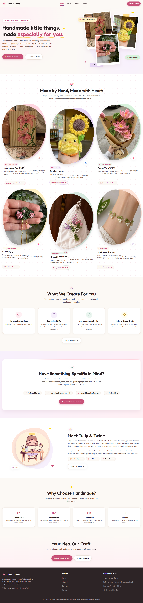

# Tulip & Twine

A pastel, handmade-crafts creative studio, built as a responsive four-page company website.

**WeIntern Full Stack Development Internship, Week 2, Task 1: Responsive Company Website.**
This is the Week 1 Tulip & Twine landing page, extended from one page to four. The brand, colours, fonts, photographs and copy are the original ones.

## Overview

Tulip & Twine is a small creative studio making handmade paintings, crochet, fuzzy wire crafts, clay pieces, beaded keychains and personalised jewellery. The site presents the studio in a warm, playful, pastel style: rounded type, soft colour, hand-drawn illustration and gentle motion throughout.

It is a static frontend project. There is no backend, and the contact form does not send anything anywhere.

## Pages

| Page | File | What it contains |
| --- | --- | --- |
| Home | `index.html` | Hero with two calls to action, the six craft categories, a four-card services preview, the custom order banner, a short "Meet Tulip & Twine" introduction, "Why Choose Handmade?", and a closing call to action |
| About | `about.html` | The studio's story, mission and vision, four core values, the team section, and a call to action |
| Services | `services.html` | Six service cards with what each includes, craft shortcuts into the request form, the four-step custom order process, and a call to action |
| Contact | `contact.html` | Studio details (demo), a list of what is helpful to include, and the custom order request form with validation |

Every page shares the same header, navigation and footer, and each one works when opened directly, refreshed, or reached from another page.

The team section is honest about the studio: Tulip & Twine is presented as a one-maker studio, so the cards show the maker and her three craft desks instead of invented staff.

## Features

- Four linked pages with a shared sticky header and footer
- Responsive navigation: inline links on wide screens, a dropdown panel at 768px and below, opened with a hamburger button
- The current page is marked in the navigation, visually and with `aria-current="page"`
- Mobile menu that closes on Escape (returning focus to its button), on an outside tap, or on picking a link, and resets itself if the window is resized back to desktop width
- Scroll reveal: sections fade and rise into place as they scroll into view. Without JavaScript everything is simply visible
- Hand-drawn SVG illustrations throughout (the tulip logo, section decorations), with a shimmer sweep on primary buttons and craft cards
- Six craft categories, each with a real handmade-craft photograph and a link that opens the request form with that craft already selected
- Contact form with field-level validation and accessible error messages
- Visible keyboard focus states and a skip link on every page
- `prefers-reduced-motion` support: all animation and motion is switched off and reveals show immediately

## Tech Stack

- HTML5
- CSS3 (Grid, Flexbox, custom properties, `clamp()`)
- Vanilla JavaScript (ES6+)
- WebP images (the author's own handmade-craft photography, plus one illustrated maker avatar)
- Inline SVG for the logo, icons and decorations
- Self-hosted WOFF2 fonts: Fredoka and Outfit

Plain HTML, CSS and JavaScript only, with no framework, no build step and no npm dependencies. Icons are inline SVG, so no icon library is loaded.

## Project Structure

```
business-landing-page/
├── index.html
├── about.html
├── services.html
├── contact.html
├── css/
│   └── style.css
├── js/
│   └── script.js
├── assets/
│   ├── fonts/
│   └── images/
├── screenshots/
├── favicon.svg
├── DESIGN_DECISIONS.md
└── README.md
```

`assets/fonts/` holds the WOFF2 files and their licence texts (SIL Open Font License). `assets/images/` holds the WebP craft photographs and the illustrated maker avatar. One stylesheet and one script are shared by all four pages.

## Running Locally

No installation is needed. From this folder:

```bash
python -m http.server 8000
```

Then open http://localhost:8000

Opening any of the four `.html` files directly in a browser also works.

## Responsive Design

The base styles for the new pages are written mobile-first, and the layout changes at these widths:

| Width | What changes |
| --- | --- |
| up to 480px | Header button is hidden (the menu still reaches Contact), long button labels may wrap, cards use less inner padding |
| up to 768px | Navigation becomes a hamburger menu, form fields stack in one column, footer stacks |
| up to 992px | Home hero and story sections stack to one column |
| 520px and up | "Why handmade" and process cards go two across |
| 560px and up | Service and value cards go two across |
| 620px / 640px and up | Craft cards, detailed service cards and team cards go two across |
| 1024px and up | Craft and detailed service cards go three across, team and process cards four across, contact details sit beside the form |
| 1100px and up | Service and value cards go four across |

All four pages were checked in headless Chrome at 320, 375, 390, 640, 768, 1024, 1280, 1440 and 1920px wide. See [Testing](#testing).

## Contact Form Validation

The form uses HTML5 attributes (`required`, `type="email"`, `minlength`, `maxlength`) together with JavaScript.

| Field | Rule |
| --- | --- |
| Full Name | Required, at least 2 characters |
| Email Address | Required, must look like `name@example.com` |
| Phone Number | Optional. If filled, 7 to 15 digits |
| Inquiry / Craft Type | Required, one option must be chosen |
| Preferred Colour Palette | Optional |
| Message | Required, 20 to 1000 characters, with a live character count |

How it behaves:

- A field is checked when you leave it, and again while you correct it, so an error disappears as soon as the value is valid.
- On submit, every field is checked. Each invalid field gets its own message underneath, linked with `aria-describedby` and marked `aria-invalid`. Focus moves to the first invalid field and a summary says how many fields need attention.
- An invalid form is never submitted.
- A valid form shows a confirmation and is cleared.

### Limitation: the form is a frontend demo

There is no backend or email service behind the form. **Nothing is sent, emailed or saved.** The confirmation message says so plainly: "This is a demo form, so nothing was sent or saved." The email address shown on the site uses the reserved `.example` domain and does not receive mail.

## Accessibility

- Semantic landmarks (`header`, `nav`, `main`, `footer`, `aside`) and one `h1` per page
- A skip link to the main content
- Labelled form fields, with hints for optional fields
- Descriptive alt text on every photograph and the illustrated avatar; decorative icons are hidden from assistive technology
- Hamburger button with `aria-label`, `aria-controls` and a correct `aria-expanded` state
- Keyboard support for the menu, including Escape and focus return
- Tap targets at least 40px tall on phones and tablets
- Reduced-motion support

## Testing

These checks were run with an automated headless Chrome script against a local server. All of them passed.

- **Responsive:** each of the four pages at the nine widths listed above. No horizontal scrolling, no content outside the viewport, no cut-off text, all images loaded, every section revealed, no console or network errors, and no tap target under 40px tall at 768px and below.
- **Links:** every internal link on every page returns a page, and every in-page anchor exists.
- **Navigation:** on each page, the hamburger opens and closes the menu by click, Enter key, Escape and outside tap, `aria-expanded` follows it, the current page is marked, and a menu link opens the next page. At desktop width the inline navigation shows and the hamburger is hidden.
- **Keyboard:** the first Tab lands on the skip link, and focused controls show an outline.
- **Form:** empty submit, malformed emails, an invalid phone number, a too-short message, error clearing, the character counter, a valid submit (confirmation shown, form cleared, no network request), and the `?craft=` preselection.
- **Without JavaScript:** all content stays visible on all four pages.
- **Opened as files:** all four pages load their styles, fonts and images from disk, and navigation between them works.

Not tested: physical phones or tablets, browsers other than Chrome, and screen readers.

## Deployment

The site is static, and every link and asset path is relative, so it works from any folder on any static host. No build command is needed.

**Vercel**

1. Import the repository at vercel.com.
2. Set **Root Directory** to `business-landing-page` and **Framework Preset** to `Other`.
3. Leave the build command and output directory empty, then deploy.

**Netlify**

1. Add a new site from the repository.
2. Set **Base directory** and **Publish directory** to `business-landing-page`, leave the build command empty, then deploy.

**GitHub Pages**

GitHub Pages serves a repository from its root or from a `/docs` folder, so this subfolder is reached by its path: enable Pages for the `main` branch (root) in the repository settings, then open `https://<username>.github.io/week1-assignments/business-landing-page/`.

## Live Website

Live website: https://tulip-and-twine.vercel.app/

## Screenshots

Full-page captures of all four pages are in [`screenshots/`](screenshots/), taken at 390px (mobile), 768px (tablet) and 1440px (desktop).

| Page | Mobile | Tablet | Desktop |
| --- | --- | --- | --- |
| Home | [home-mobile.png](screenshots/home-mobile.png) | [home-tablet.png](screenshots/home-tablet.png) | [home-desktop.png](screenshots/home-desktop.png) |
| About | [about-mobile.png](screenshots/about-mobile.png) | [about-tablet.png](screenshots/about-tablet.png) | [about-desktop.png](screenshots/about-desktop.png) |
| Services | [services-mobile.png](screenshots/services-mobile.png) | [services-tablet.png](screenshots/services-tablet.png) | [services-desktop.png](screenshots/services-desktop.png) |
| Contact | [contact-mobile.png](screenshots/contact-mobile.png) | [contact-tablet.png](screenshots/contact-tablet.png) | [contact-desktop.png](screenshots/contact-desktop.png) |



The captures were taken with reduced motion switched on, so every section is shown at once instead of fading in on scroll.

## Design Notes

See [DESIGN_DECISIONS.md](DESIGN_DECISIONS.md) for the reasoning behind the brand, layout, navigation, form and accessibility choices.

## Author

Mimansa Patle

- GitHub: https://github.com/Mimansapatle
- LinkedIn: https://www.linkedin.com/in/mimansa-patle-b489a6309/

## Project Note

Tulip & Twine is presented here as a demonstration studio, built for frontend web development practice. The studio hours, response time and contact details are for demonstration only, and the custom order form does not send anything anywhere. The craft photographs are the author's own handmade work; the maker's portrait is an AI-generated illustrated avatar, not a photograph.
