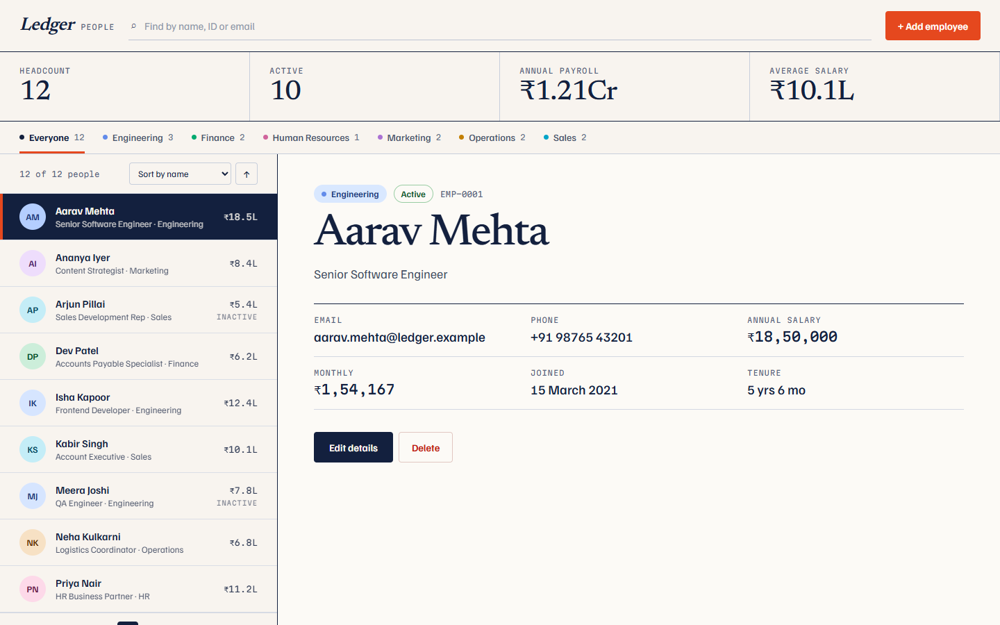
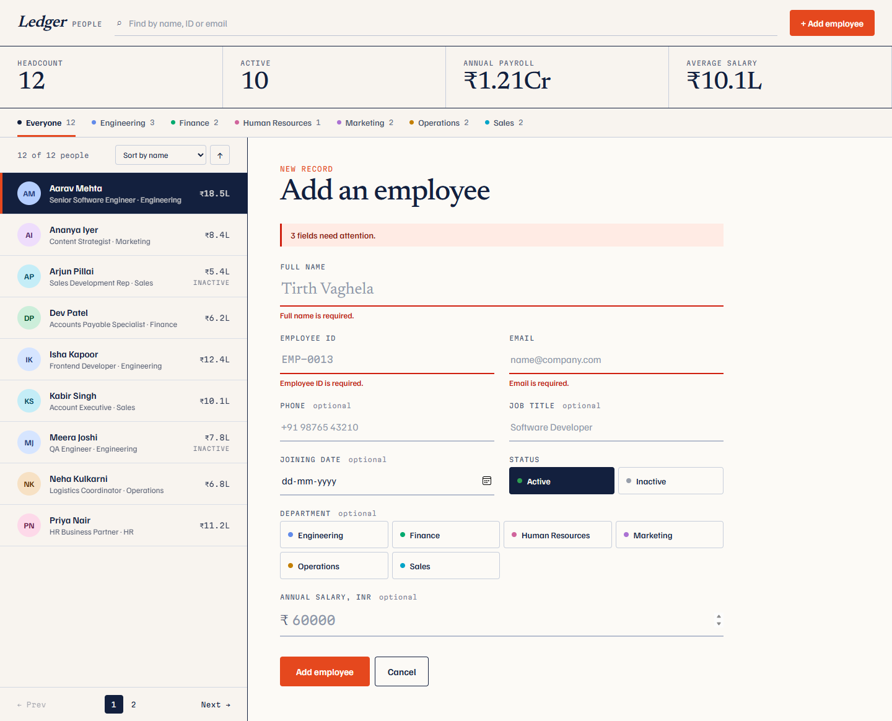
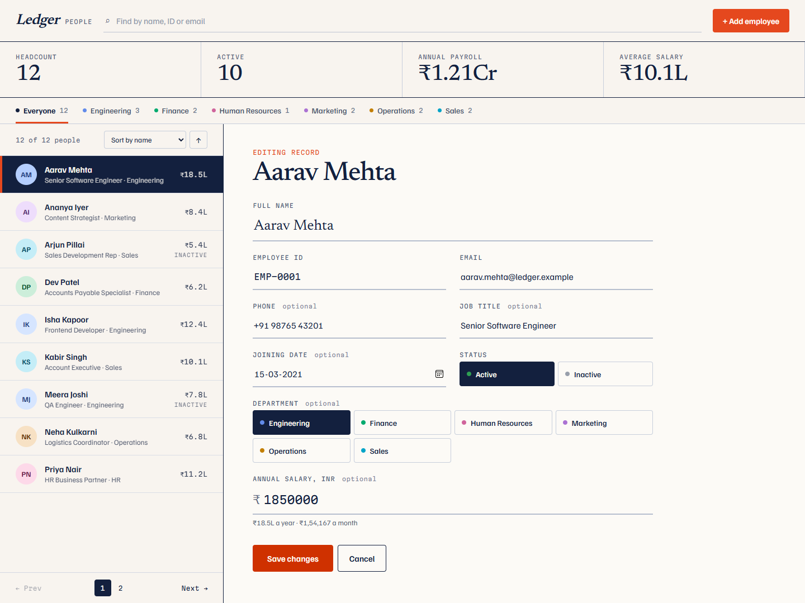
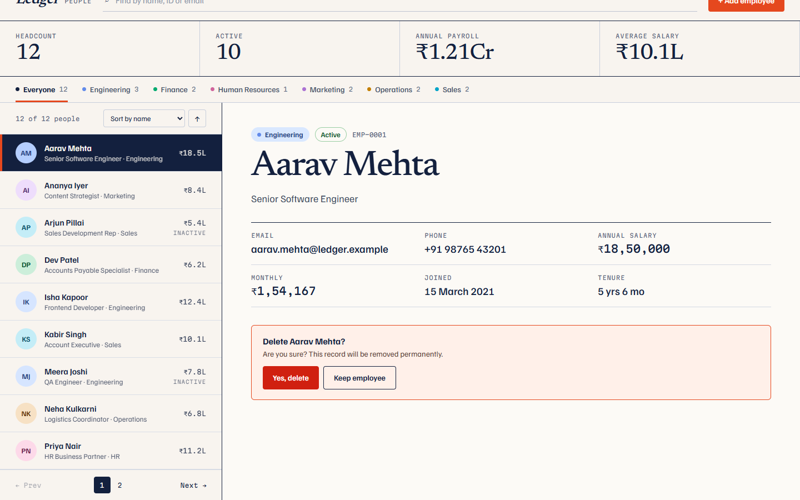
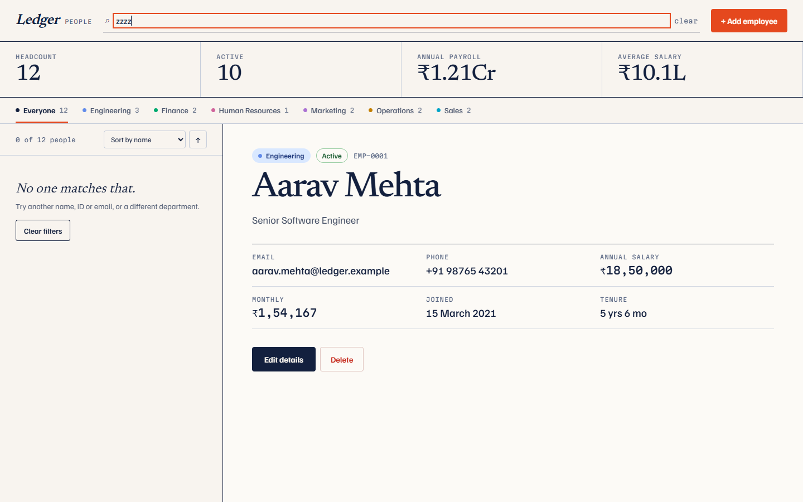
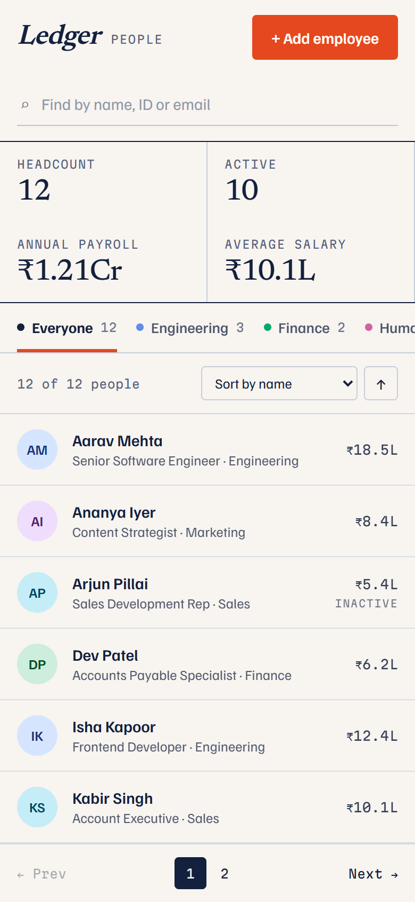
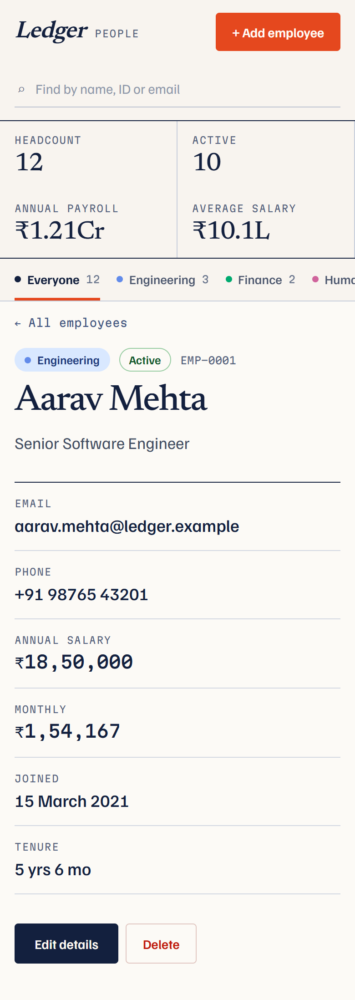

# Employee Management System (MERN)

Week 2, Task 2 of a Full Stack Development internship: an employee directory where records can be added, viewed, edited, searched and deleted.

The React frontend calls an Express REST API, and the API stores the employees in MongoDB through Mongoose.

**Live demo:** https://employee-app-bice.vercel.app

**Live API:** https://employee-api-rust-nu.vercel.app/api/health



## 1. Overview

The app is called "Ledger". An HR administrator sees every employee in a list, opens one to read the details, and can add, edit or delete a record. A summary bar shows the headcount, how many employees are active, the annual payroll and the average salary. Every change goes through the API and is saved in MongoDB, so the data is still there after a page refresh or a server restart.

## 2. Objective

The task is to build a working full stack CRUD application:

- a React frontend built from components and hooks
- a Node.js and Express REST API
- MongoDB for storage, with a Mongoose schema
- Create, Read, Update and Delete working end to end, with search, filtering, validation and error handling

## 3. Technology Stack

| Layer | Technology |
| --- | --- |
| Frontend | React 19, Vite, JavaScript, plain CSS |
| API calls | The browser's `fetch` |
| Backend | Node.js, Express 5 |
| Database | MongoDB, with Mongoose 9 |
| Other backend packages | `cors`, `dotenv` |
| Tests | Node's built-in test runner (`node --test`), Postman |

No UI library, no state library and no test library is installed.

## 4. Features

- **Dashboard** with headcount, active employees, annual payroll and average salary, all worked out from the records the API returns
- **Department tabs** with a count for each department
- **Add employee** through a validated form
- **View employees** in a sortable, paged list, with a detail pane for the selected employee
- **Search** by name, employee ID or email, and **filter** by department, with a "clear" button and a "Clear filters" button
- **Edit employee** in the same form, filled with the current values
- **Delete employee**, only after a confirmation
- **Validation** in the browser and again in the API: required fields, email format, unique employee ID, non-negative salary, realistic phone number and joining date
- **Feedback** for every outcome: loading placeholders, an empty state, a "no match" state, a connection error with "Try again", messages on each invalid field, and a short confirmation after each successful add, update and delete
- **Responsive layout**: list and detail side by side on wide screens, one at a time below 860px

Each employee has these fields:

| Field | Required | Rule |
| --- | --- | --- |
| Employee ID | Yes | 2 to 20 letters, numbers or hyphens. Unique. Stored in upper case. |
| Full name | Yes | 2 to 80 characters, with at least one letter |
| Email | Yes | A valid email address. Stored in lower case. |
| Phone | No | 7 to 15 digits; spaces, `+`, `-`, `.` and brackets allowed |
| Department | No | Up to 50 characters |
| Job title | No | Up to 80 characters |
| Joining date | No | A real date between 1970 and one year from today |
| Salary | No | A number from 0 to 100,000,000 (annual, in rupees) |
| Status | No | `Active` or `Inactive`. Defaults to `Active`. |

## 5. Project Structure

```
new_task-2-employee-management/
├── backend/
│   ├── server.js                    Entry point: loads .env, connects, starts the API
│   ├── app.js                       Express app: CORS, JSON parsing, routes, error handling
│   ├── config/
│   │   └── db.js                    MongoDB connection and index creation
│   ├── models/
│   │   └── Employee.js              Mongoose schema and validation rules
│   ├── controllers/
│   │   └── employeeController.js    The five employee handlers
│   ├── routes/
│   │   └── employeeRoutes.js        Maps URLs to the controller
│   ├── middleware/
│   │   ├── checks.js                Database-available and valid-id checks
│   │   └── errorHandler.js          Turns every error into a JSON response
│   ├── tests/
│   │   └── employees.test.js        API tests
│   ├── seed.js                      Optional sample data
│   ├── package.json
│   └── .env.example
├── frontend/
│   ├── index.html
│   ├── vite.config.js
│   ├── package.json
│   ├── .env.example
│   └── src/
│       ├── main.jsx
│       ├── App.jsx
│       ├── styles.css
│       ├── constants.js             Departments, sort options, page sizes
│       ├── pages/
│       │   └── Dashboard.jsx        All state, and the create/update/delete handlers
│       ├── components/
│       │   ├── Header.jsx
│       │   ├── EmployeeSearch.jsx
│       │   ├── StatsBar.jsx
│       │   ├── DepartmentTabs.jsx
│       │   ├── EmployeeList.jsx     Rows, sorting, paging
│       │   ├── EmployeeDetail.jsx   One employee, with Edit and Delete
│       │   ├── EmployeeForm.jsx     Add and Edit form
│       │   ├── ConfirmDialog.jsx
│       │   ├── LoadingState.jsx
│       │   ├── ErrorMessage.jsx
│       │   ├── EmptyState.jsx
│       │   └── ToastList.jsx
│       ├── services/
│       │   └── employeeApi.js       Every API call
│       ├── hooks/
│       │   └── useMediaQuery.js
│       └── utils/
│           ├── validation.js        Form rules
│           └── format.js            Money, dates, initials
├── postman/
│   └── Employee-Management-API.postman_collection.json
├── screenshots/
├── .gitignore
└── README.md
```

The frontend and backend are separate applications. React never connects to MongoDB; it only calls the API.

A request travels like this: a component calls a function in `employeeApi.js`, which sends a `fetch` request. Express matches the URL in `employeeRoutes.js`, runs the checks in `middleware/checks.js`, and calls a function in `employeeController.js`. The controller uses the `Employee` model to read or write MongoDB and answers with JSON. If anything throws, `errorHandler.js` builds the error response.

## 6. Prerequisites

| Tool | Version |
| --- | --- |
| [Node.js](https://nodejs.org/) | 20 or newer (includes npm) |
| [MongoDB](https://www.mongodb.com/try/download/community) | 6 or newer, local or an Atlas cluster |
| [Postman](https://www.postman.com/downloads/) | Optional, for trying the API by hand |

## 7. Installation

Install the backend and the frontend packages. Run these from the project folder.

```powershell
cd backend
npm install

cd ..\frontend
npm install
```

## 8. Environment Configuration

No password or connection string is written in the code. Real `.env` files are listed in `.gitignore` and must never be committed; only the `.env.example` files, which hold placeholders, are.

**Backend.** Create `backend/.env` from the example:

```powershell
cd backend
copy .env.example .env
```

On macOS or Linux use `cp .env.example .env`.

| Variable | Default | Purpose |
| --- | --- | --- |
| `PORT` | `5000` | Port the API listens on |
| `MONGODB_URI` | `mongodb://127.0.0.1:27017/employee_management_mern` | MongoDB connection string. The last part is the database name. |
| `CLIENT_ORIGIN` | `http://localhost:5173` | Address of the React app allowed to call the API from a browser. Separate several with commas. |

The backend also starts without a `.env` file, using the defaults above.

**Frontend.** A `.env` file is only needed if the API is not at the default address.

| Variable | Default | Purpose |
| --- | --- | --- |
| `VITE_API_URL` | `http://localhost:5000/api` | Base URL of the API |

## 9. MongoDB Setup

**Local MongoDB.** Install MongoDB Community Server and make sure it is running. On Windows it runs as a service called "MongoDB". The default `MONGODB_URI` then works as it is.

You do not need to create anything by hand. On first start the backend creates the `employee_management_mern` database, the `employees` collection and the unique index on `employeeId`.

**MongoDB Atlas.** Create a free cluster and a database user, allow your IP address under Network Access, and put the connection string in `backend/.env`, keeping the database name at the end:

```
MONGODB_URI=mongodb+srv://<username>:<password>@<cluster>.mongodb.net/employee_management_mern
```

**Sample data (optional).** To start with 12 sample employees:

```powershell
cd backend
npm run seed
```

`npm run seed -- --reset` deletes every employee first and then adds the samples.

## 10. Starting the Backend

```powershell
cd backend
npm start
```

The API runs at `http://localhost:5000`. Use `npm run dev` instead to restart automatically when a file changes.

Open `http://localhost:5000/api/health` to check it. `"database": "connected"` means MongoDB is reachable.

If MongoDB is not running, the API still starts. It logs the problem, tries again every 5 seconds, and answers employee requests with status 503 until the database is back.

## 11. Starting the Frontend

In a second terminal:

```powershell
cd frontend
npm run dev
```

Open `http://localhost:5173` in a browser.

`npm run build` creates the production build in `frontend/dist`.

## 12. API Documentation

Base URL: `http://localhost:5000/api`

Every response is JSON. Successful responses have `"success": true`. Errors have this shape:

```json
{
  "success": false,
  "message": "Please correct the highlighted fields.",
  "errors": { "email": "Enter a valid email address, like name@company.com." }
}
```

`errors` appears only when the problem belongs to particular fields.

| Method | Endpoint | Purpose | Success |
| --- | --- | --- | --- |
| GET | `/api/health` | Check that the API is running and whether the database is connected | 200 |
| GET | `/api/employees` | Get all employees | 200 |
| GET | `/api/employees/:id` | Get one employee | 200 |
| POST | `/api/employees` | Create an employee | 201 |
| PUT | `/api/employees/:id` | Update an employee | 200 |
| DELETE | `/api/employees/:id` | Delete an employee | 200 |

`:id` is the MongoDB id returned as `id`, not the Employee ID.

### GET /api/health

```json
{ "success": true, "status": "ok", "database": "connected", "uptime": 42 }
```

### GET /api/employees

Returns every employee, sorted by name.

Optional query parameters:

| Parameter | Effect |
| --- | --- |
| `search` | Matches part of the name, employee ID or email, ignoring case |
| `department` | Only employees in exactly this department |
| `status` | `Active` or `Inactive` |

Example: `GET /api/employees?search=mehta&department=Engineering`

```json
{
  "success": true,
  "count": 1,
  "data": [
    {
      "id": "6ac9eb5b965e3f78eee6ba5c",
      "employeeId": "EMP-0001",
      "fullName": "Aarav Mehta",
      "email": "aarav.mehta@ledger.example",
      "phone": "+91 98765 43201",
      "department": "Engineering",
      "jobTitle": "Senior Software Engineer",
      "joiningDate": "2021-03-15",
      "salary": 1850000,
      "status": "Active",
      "createdAt": "2026-10-10T07:38:03.559Z",
      "updatedAt": "2026-10-10T07:38:03.559Z"
    }
  ]
}
```

Optional fields that were never filled in are left out, except `joiningDate`, which is `null`.

### GET /api/employees/:id

Returns `{ "success": true, "data": { ...employee } }`.

### POST /api/employees

Request body:

```json
{
  "employeeId": "EMP-0013",
  "fullName": "Tara Bose",
  "email": "tara.bose@ledger.example",
  "phone": "+91 90000 12345",
  "department": "Finance",
  "jobTitle": "Data Analyst",
  "joiningDate": "2025-01-06",
  "salary": 1200000,
  "status": "Active"
}
```

Only `employeeId`, `fullName` and `email` are required. Fields that are not listed above are ignored.

Answers **201** with `{ "success": true, "message": "Employee added successfully.", "data": { ...employee } }`.

### PUT /api/employees/:id

Takes the same body as POST. Fields left out keep their value; an optional field sent as `""` or `null` is cleared.

Answers **200** with `{ "success": true, "message": "Employee updated successfully.", "data": { ...employee } }`.

### DELETE /api/employees/:id

Answers **200** with `{ "success": true, "message": "Employee deleted successfully.", "data": { "id": "..." } }`.

### Error responses

| Status | When |
| --- | --- |
| 400 | A field is missing or invalid, the body is not valid JSON or not a JSON object, or `:id` is not a valid MongoDB id |
| 404 | No employee has that id, or the URL does not exist |
| 409 | Another employee already has that Employee ID |
| 503 | MongoDB cannot be reached |
| 500 | Any unexpected error. The message is generic and no stack trace is sent. |

## 13. Testing

### Backend tests

The tests start the real Express app and use a real MongoDB database called `employee_management_mern_test`, which they create and delete themselves. MongoDB must be running.

```powershell
cd backend
npm test
```

There are 36 tests, covering:

- the health endpoint
- creating, listing, fetching, updating and deleting, each checked in the database
- every validation rule, invalid JSON and non-object bodies
- duplicate Employee IDs (409), including on update, and the unique index itself
- missing employees (404) and malformed ids (400)
- search and the department and status filters
- CORS, and that error responses contain no stack trace
- the 503 response while the database is disconnected

To use a different database for the tests, set `MONGODB_TEST_URI`.

### Postman

Import `postman/Employee-Management-API.postman_collection.json`. With the backend running, run the collection from top to bottom. It has 13 requests with 26 checks: health, the full create/read/update/search/delete cycle, and the 400, 404 and 409 cases. The record it creates is deleted again at the end.

### Manual test of the full flow

With MongoDB, the backend and the frontend all running:

1. **Add.** Click "+ Add employee", fill in the form and save. A confirmation appears and the new employee opens.
2. **Check the database.** In `mongosh`:

   ```
   use employee_management_mern
   db.employees.find()
   ```

3. **Validation.** Open the form again and save it empty. Three "required" messages appear. Try an Employee ID that already exists: the API answers 409 and the message appears under that field.
4. **Search and filter.** Type a name, an ID or part of an email. Click a department tab. Use "clear" and "Clear filters".
5. **Edit.** Open an employee, click "Edit details", change something and save. Refresh the page: the change is still there.
6. **Delete.** Click "Delete", then "Keep employee" (nothing happens), then "Delete" and "Yes, delete".
7. **Errors.** Stop the backend and refresh the page: "The server isn't answering." appears with a "Try again" button. Start the backend and click it.

### Results

These were run on 10 October 2026:

| Check | Result |
| --- | --- |
| Backend tests (`npm test`) | 36 of 36 passed |
| Postman collection (run with Newman) | 13 requests, 26 of 26 checks passed |
| Full flow in a real browser (Microsoft Edge) against the running API and MongoDB | 71 of 71 checks passed, including layouts from 320px to 1920px |
| Frontend production build (`npm run build`) | Succeeded, no warnings |
| API started while MongoDB was unreachable | Stayed up, health reported `disconnected`, employee requests answered 503 |

## 14. Screenshots

| Add employee, with validation messages | Edit employee |
| --- | --- |
|  |  |

| Delete confirmation | Search with no match |
| --- | --- |
|  |  |

| Employee list on a phone | Employee detail on a phone |
| --- | --- |
|  |  |

## 15. Known Limitations

- **No sign-in.** The task does not ask for authentication, so anyone who can reach the API can read and change the data.
- **The whole list is loaded at once.** Search, filtering, sorting and paging happen in the browser, which is fast for hundreds of employees but would need server-side paging for many thousands. The API already supports `search`, `department` and `status`.
- **No protection against simultaneous edits.** If two people edit the same employee, the last save wins. Editing or deleting a record that someone else has already deleted shows a message and refreshes the list.
- **Emails are not unique.** Only the Employee ID must be unique, as the task requires.
- **One currency.** Salaries are stored as plain numbers and always shown in Indian rupees.
- **Fonts come from Google Fonts.** Without an internet connection the app works but falls back to system fonts.
- **Tested in Chromium only** (Microsoft Edge). Firefox, Safari and physical phones were not tested.
- **Not deployed.** The project runs locally.
