# Nexus Authentication System

Week 2, Task 3 of the WeIntern Full Stack Development internship: a registration and login system with a protected dashboard, built on the MERN stack.

A React frontend talks to an Express REST API. Accounts are stored in MongoDB with bcrypt-hashed passwords, a login is a signed JWT, and logging out revokes that token on the server.

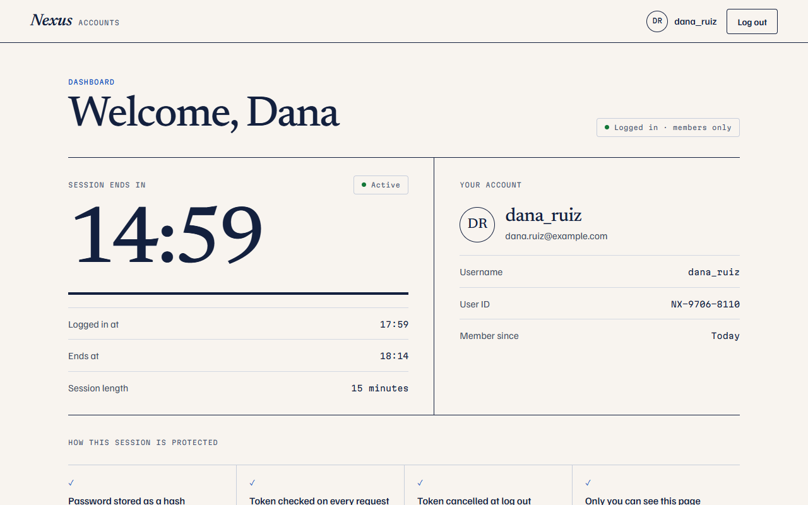

## Table of Contents

1. [Overview](#overview)
2. [Features](#features)
3. [Technology Stack](#technology-stack)
4. [Project Structure](#project-structure)
5. [Prerequisites](#prerequisites)
6. [Installation](#installation)
7. [Environment Setup](#environment-setup)
8. [Starting MongoDB](#starting-mongodb)
9. [Running the Application](#running-the-application)
10. [API Documentation](#api-documentation)
11. [Authentication and Logout](#authentication-and-logout)
12. [Security Decisions](#security-decisions)
13. [Testing](#testing)
14. [Screenshots](#screenshots)
15. [Known Limitations](#known-limitations)
16. [Troubleshooting](#troubleshooting)

## Overview

A visitor can create an account, log in with their email or username, open a dashboard that only logged-in users can reach, and log out.

| Screen | Address | Who can open it |
| --- | --- | --- |
| Register | `/register` | Anyone |
| Log in | `/login` | Anyone |
| Dashboard | `/dashboard` | Logged-in users only |

Any other address goes to the dashboard, which sends a visitor who is not logged in to the login page.

## Features

- **Registration** with username, email, password and password confirmation
- **Login** with either the email address or the username
- **Password hashing** with bcrypt; the plain password is never stored or returned
- **JWT authentication**: the server signs a token at login and verifies it on every protected request
- **Protected dashboard** showing only the logged-in user's own username, email and sign-up date
- **Logout with server-side revocation**: the token stops working immediately, even if someone kept a copy
- **Automatic sign-out** when the token expires or is revoked
- **Validation** in the browser and again on the server, with sanitization of every value
- **Duplicate protection** for both email and username, enforced by unique indexes in MongoDB
- **Rate limiting** on login and registration
- **Clear messages** for invalid input, wrong credentials, duplicate accounts, an ended session and an unreachable server
- **Password strength meter** and Show/Hide buttons on password fields
- **Session countdown** on the dashboard, with a warning in the last five minutes
- **Responsive layout** for desktop, tablet and mobile

The interface has a warm, editorial look: a cream background, Newsreader serif headings, Familjen Grotesk for text, Martian Mono for small labels, heavy ink rules between sections, and one deep blue accent. The register and log in pages have a wide headline across the top, with the form on the left under it and a numbered list of how an account is protected on the right; every line in it describes something the backend really does (see [Security Decisions](#security-decisions)).

## Technology Stack

| Layer | Technology |
| --- | --- |
| Frontend | React 18, Vite 5, React Router 6, plain CSS |
| Backend | Node.js, Express 4 |
| Database | MongoDB with Mongoose 8 |
| Password hashing | bcryptjs (cost factor 12) |
| Authentication | JSON Web Tokens (`jsonwebtoken` 9.0.x) |
| Security middleware | `helmet`, `cors`, `express-rate-limit` |
| Validation | `validator`, plus the checks in `middleware/validateRequest.js` |
| Tests | Jest and Supertest |

## Project Structure

```
new_task-3-authentication-system/
├── backend/
│   ├── server.js                    Entry point: checks settings, connects, starts the API
│   ├── app.js                       Express app: security headers, CORS, rate limits, routes
│   ├── config/
│   │   ├── env.js                   Loads backend/.env and checks the required settings
│   │   └── db.js                    MongoDB connection
│   ├── models/
│   │   ├── User.js                  User schema, password hashing, safe JSON
│   │   └── RevokedToken.js          Ids of logged-out tokens
│   ├── controllers/
│   │   └── authController.js        register, login, current user, logout
│   ├── routes/
│   │   └── authRoutes.js            Maps URLs to the controller
│   ├── middleware/
│   │   ├── authMiddleware.js        protect: verifies the JWT on protected routes
│   │   ├── validateRequest.js       Input validation and sanitization
│   │   └── errorHandler.js          Turns every error into a JSON response
│   ├── utils/
│   │   └── jwt.js                   Sign and verify tokens
│   ├── tests/
│   │   ├── setupEnv.js              Points the tests at their own database
│   │   └── auth.test.js             API tests
│   ├── package.json
│   └── .env.example
├── frontend/
│   ├── index.html
│   ├── vite.config.js
│   ├── package.json
│   ├── .env.example
│   ├── public/favicon.svg
│   └── src/
│       ├── main.jsx
│       ├── App.jsx                  The routes
│       ├── context/AuthContext.jsx  Login state, session checks, logout
│       ├── components/
│       │   ├── AuthShell.jsx        Top bar, headline band, form and the list of protections
│       │   ├── FormParts.jsx        Field, Banner, SubmitButton, Spinner
│       │   └── ProtectedRoute.jsx   Guards the dashboard; "Checking your session…" screen
│       ├── services/authApi.js      Every API call
│       ├── pages/
│       │   ├── Register.jsx
│       │   ├── Login.jsx
│       │   └── Dashboard.jsx
│       ├── content/copy.js          Brand name, field messages, banners, protection lists
│       ├── utils/
│       │   ├── validation.js        Form rules and password strength
│       │   └── format.js            Countdown, dates, initials, token times
│       └── styles.css
├── screenshots/
├── README.md
└── .gitignore
```

## Prerequisites

| Tool | Version |
| --- | --- |
| [Node.js](https://nodejs.org/) | 18 or newer (includes npm) |
| [MongoDB](https://www.mongodb.com/try/download/community) | 6 or newer, running locally, or an Atlas cluster |

## Installation

The backend and the frontend are separate npm projects. Install each one from its own folder.

```powershell
cd backend
npm install

cd ..\frontend
npm install
```

Do not install packages one at a time, and do not run `npm install` in the project root: there is no `package.json` there.

## Environment Setup

No secret is written in the code. Real `.env` files are listed in `.gitignore` and must never be committed; only the `.env.example` files, which hold placeholders, are.

### Backend

Create `backend/.env` by copying the example:

```powershell
cd backend
copy .env.example .env
```

On macOS or Linux use `cp .env.example .env`.

Then generate a secret and paste it in as `JWT_SECRET`:

```powershell
node -e "console.log(require('crypto').randomBytes(48).toString('hex'))"
```

| Variable | Example | Purpose |
| --- | --- | --- |
| `PORT` | `5001` | Port the API listens on |
| `MONGODB_URI` | `mongodb://127.0.0.1:27017/authentication_system_mern` | MongoDB connection string. The last part is the database name. **Required.** |
| `JWT_SECRET` | a long random value | Key used to sign tokens. **Required**, at least 32 characters. |
| `JWT_EXPIRES_IN` | `15m` | How long a login lasts |
| `FRONTEND_URL` | `http://localhost:5173` | Address of the React app that may call the API. Separate several with commas. |
| `NODE_ENV` | `development` | |

The server loads `backend/.env` by its full path, so it is found whichever folder you start the server from. If `MONGODB_URI` or `JWT_SECRET` is missing, if the secret is shorter than 32 characters, or if it is still the placeholder from `.env.example`, the server stops with a message that says exactly what to fix. There is no fallback secret.

`FRONTEND_URL` must match the address the frontend really runs on (`http://localhost:5173`). If they differ, the browser blocks every request and the login page reports that it cannot reach the server.

### Frontend

A `.env` file is only needed if the API is not at the default address.

| Variable | Default | Purpose |
| --- | --- | --- |
| `VITE_API_URL` | `http://localhost:5001` | Address of the API |

Never put a secret in a `VITE_` variable: those values are built into the JavaScript that every visitor downloads.

## Starting MongoDB

On Windows, MongoDB Community Server runs as a service called "MongoDB". Check it and start it from an **Administrator** PowerShell:

```powershell
Get-Service MongoDB
net start MongoDB
```

On macOS with Homebrew: `brew services start mongodb-community`. On Linux: `sudo systemctl start mongod`.

You do not need to create anything by hand. On first start the backend creates the `authentication_system_mern` database, the `users` collection and its unique indexes. No sample users are needed; register one through the app.

## Running the Application

Use two terminals.

**Terminal 1, backend:**

```powershell
cd backend
npm start
```

It prints the database name and `Server running on http://localhost:5001`. `npm run dev` does the same and restarts when a file changes.

**Terminal 2, frontend:**

```powershell
cd frontend
npm run dev
```

It opens `http://localhost:5173`. The port is fixed: if 5173 is already in use, Vite stops with an error instead of quietly moving to another port, because the backend only accepts requests from the address in `FRONTEND_URL`.

To check the backend by itself, open `http://localhost:5001/api/health`.

## API Documentation

Base URL: `http://localhost:5001`

Every response is JSON. Errors always have `"success": false` and a `message`. Validation errors also have `fields`, and authentication errors on protected routes also have a `code`.

| Method | Endpoint | Purpose | Token required |
| --- | --- | --- | --- |
| GET | `/api/health` | Server and database status | No |
| POST | `/api/auth/register` | Create an account | No |
| POST | `/api/auth/login` | Log in and receive a token | No |
| GET | `/api/auth/me` | The logged-in user's profile | **Yes** |
| POST | `/api/auth/logout` | Log out and revoke the token | **Yes** |

Protected routes expect the header `Authorization: Bearer <token>`.

### GET /api/health

**200 OK**

```json
{
  "status": "ok",
  "message": "Server is running",
  "database": "connected",
  "timestamp": "2026-10-10T11:40:17.373Z"
}
```

### POST /api/auth/register

Request:

```json
{
  "username": "dana_ruiz",
  "email": "dana.ruiz@example.com",
  "password": "Harbor2026",
  "confirmPassword": "Harbor2026"
}
```

| Field | Rule |
| --- | --- |
| `username` | 3 to 30 characters: letters, numbers, underscores or hyphens. Stored in lower case. |
| `email` | A valid email address. Stored in lower case. |
| `password` | 8 to 72 characters, with at least one uppercase letter, one lowercase letter and one number |
| `confirmPassword` | Must equal `password` |

**201 Created** (registering does not log the user in, so there is no token)

```json
{
  "success": true,
  "message": "User registered successfully",
  "user": {
    "id": "6ac9f1b2965e3f78eee6ba5c",
    "username": "dana_ruiz",
    "email": "dana.ruiz@example.com",
    "createdAt": "2026-10-10T11:38:26.512Z"
  }
}
```

Errors:

| Status | When | Example body |
| --- | --- | --- |
| 400 | A field is missing or invalid | `{ "success": false, "message": "Validation failed", "fields": { "password": "Password must contain at least one uppercase letter" } }` |
| 409 | The email or username is taken | `{ "success": false, "message": "Email already exists", "fields": { "email": "Email already exists" } }` |
| 429 | Too many registrations from one address | `{ "success": false, "message": "Too many attempts. Please try again in a few minutes." }` |

### POST /api/auth/login

Request (the `email` field holds either the email address or the username):

```json
{
  "email": "dana_ruiz",
  "password": "Harbor2026"
}
```

**200 OK**

```json
{
  "success": true,
  "message": "Login successful",
  "token": "<JWT>",
  "user": {
    "id": "6ac9f1b2965e3f78eee6ba5c",
    "username": "dana_ruiz",
    "email": "dana.ruiz@example.com",
    "createdAt": "2026-10-10T11:38:26.512Z"
  }
}
```

Errors:

| Status | When | Body |
| --- | --- | --- |
| 400 | A field is empty or not text | `{ "success": false, "message": "Email and password are required", "fields": { ... } }` |
| 401 | Wrong password **or** unknown account | `{ "success": false, "message": "Invalid email/username or password" }` |
| 429 | Too many failed attempts | As for register |

A wrong password and an unknown account return exactly the same response.

### GET /api/auth/me

**200 OK**

```json
{
  "success": true,
  "user": {
    "id": "6ac9f1b2965e3f78eee6ba5c",
    "username": "dana_ruiz",
    "email": "dana.ruiz@example.com",
    "createdAt": "2026-10-10T11:38:26.512Z"
  }
}
```

**401 Unauthorized**, with one of these:

| `code` | `message` | When |
| --- | --- | --- |
| `TOKEN_MISSING` | No token provided | No `Authorization: Bearer` header |
| `TOKEN_INVALID` | Invalid token | Malformed, altered, signed with another key, or the account was deleted |
| `TOKEN_EXPIRED` | Token expired | Past its expiry time |
| `TOKEN_REVOKED` | Token has been revoked | The token was logged out |

### POST /api/auth/logout

No body. **200 OK**

```json
{
  "success": true,
  "message": "Logout successful"
}
```

After this the same token gets `401` with `TOKEN_REVOKED` on every protected route. Errors are the same 401 responses as for `/api/auth/me`.

### Other responses

| Status | When |
| --- | --- |
| 400 | The request body is not valid JSON |
| 404 | The address does not exist |
| 413 | The request body is larger than 10 KB |
| 500 | An unexpected error. The body is always `{ "success": false, "message": "Internal server error" }` with no technical detail. |
| 503 | MongoDB cannot be reached |

## Authentication and Logout

**Login.** The server finds the user by email or username, compares the password with the stored bcrypt hash, and signs a JWT with `JWT_SECRET`. The token contains only the user's id, a random token id (`jti`) and its issue and expiry times. It lasts 15 minutes by default.

**Using the token.** The frontend keeps the token in `localStorage` and sends it in the `Authorization` header. On every protected request the `protect` middleware checks, in order: that a token is present, that its signature and expiry are valid, that its id is not in the revoked list, and that the account still exists.

**Page refresh.** When the app loads with a stored token, it calls `GET /api/auth/me`. The session is restored only if the server accepts the token. A refused token is deleted and the visitor is sent to the login page.

**Logout.** A JWT cannot be "deleted" on the server, so removing it from the browser alone would leave any copy of it working until it expired. To really end the session, logout saves the token's id in a `revokedtokens` collection (a denylist), and `protect` refuses any token whose id is listed. MongoDB removes each record automatically at the moment the token would have expired anyway (a TTL index), so the list stays small. Only the random id is stored, never the token.

Logout revokes the one token that was used. Another device logged in to the same account keeps its own session.

**While the dashboard is open**, the app re-checks the session every minute, when the tab becomes visible again, and when the page is restored by the browser's Back button. An expired or revoked token logs the user out with a "Your session expired" message.

**The countdown.** The dashboard shows the time left in the session. It reads the issue and expiry times from the token itself, so it always shows the real length set by `JWT_EXPIRES_IN`. Reading those times does not make the browser trust the token: only the server decides whether it is valid. When the countdown reaches zero the user is returned to the login page.

## Security Decisions

| Area | Decision |
| --- | --- |
| Password storage | bcrypt with a per-password salt and cost factor 12. Only `passwordHash` is stored, and the field is excluded from queries by default. |
| Password rules | 8 to 72 characters with uppercase, lowercase and a number. 72 is bcrypt's real limit; longer passwords are refused instead of silently cut short. |
| API responses | Only `id`, `username`, `email` and `createdAt` ever leave the API. |
| Login errors | One message for a wrong password and an unknown account, and the same amount of hashing work in both cases, so neither the text nor the timing reveals which accounts exist. |
| JWT | Signed with HS256 using a secret of at least 32 characters from the environment. The algorithm is fixed when verifying, so a forged token cannot choose its own. No fallback secret. |
| Logout | Server-side revocation by token id, described above. |
| Duplicate accounts | Checked before saving, and guaranteed by unique indexes in MongoDB, so two simultaneous registrations cannot both succeed. |
| Input | Validated on the server whatever the browser checked. Values must be text: an object such as `{"$ne": ""}` sent in place of a string is rejected, which prevents MongoDB operator injection. Usernames are limited to safe characters. Unknown fields are ignored. |
| Rate limiting | Per IP address, per 15 minutes: 10 failed logins (successful ones are not counted), 10 registrations, and 300 requests to `/api/auth` overall. |
| HTTP headers | `helmet` sets the standard security headers and hides `X-Powered-By`. |
| CORS | Only the address in `FRONTEND_URL` may call the API from a browser. |
| Request size | JSON bodies are limited to 10 KB. |
| Errors | Stack traces and database messages are logged on the server only. Request bodies are never logged, so passwords and tokens do not reach the logs. |
| Secrets | Only in `backend/.env`, which Git ignores. The JWT secret is never sent to the frontend and is not a `VITE_` variable. |

## Testing

### Automated tests

```powershell
cd backend
npm test
```

The tests run the real Express app against a real MongoDB database named `authentication_system_mern_test`. `tests/setupEnv.js` forces that database and a test-only secret before the app loads, and the tests refuse to run if the database name does not end in `_test`. The development database is never touched. MongoDB must be running. To use another test database, set `MONGODB_TEST_URI`.

There are 77 tests, covering:

- Registration: success, every validation rule, weak passwords, non-text input, extra fields, duplicate email and username, and four identical registrations sent at once
- Password storage: only a bcrypt hash is saved, hashes are salted, and the password or hash never appears in a response
- Login: by username and by email, wrong password, unknown user, missing fields, injection attempts
- Tokens: missing, malformed, truncated, altered, wrongly signed, unsigned, expired, missing a token id, and for a deleted account
- Logout: the same token is rejected afterwards, only the token id is stored, other sessions keep working
- Errors: invalid JSON, oversized bodies, unknown routes, hidden internal errors, security headers
- CORS: the preflight (OPTIONS) request for each route, the allowed origin, other origins refused, no wildcard, the header on error and rate-limited responses, and how `FRONTEND_URL` is read
- Rate limiting on login and registration
- Configuration checks, and the 503 response while the database is disconnected

### Results

Run on 10 October 2026:

| Check | Result |
| --- | --- |
| `npm ci` in `backend` (clean install from the lockfile) | Succeeded |
| `npm ci` in `frontend` (clean install from the lockfile) | Succeeded |
| Backend tests (`npm test`) | 77 of 77 passed |
| Frontend production build (`npm run build`) | Succeeded, no warnings |
| Full flow in a real browser (Chrome) against the running API and MongoDB | 86 of 86 checks passed |
| Text contrast measured on the register page (11 text and background pairs) | All at or above 4.5:1 |
| Backend started from a different folder | Loaded `backend/.env` and connected to `authentication_system_mern` |
| Backend started with missing settings, the placeholder secret, and MongoDB unreachable | Stopped each time with a clear message |
| Built frontend bundle searched for the JWT secret and database address | Not present |

There is no lint or type-check command in this project.

### Manual test

With MongoDB, the backend and the frontend all running:

1. **The dashboard is protected.** Open `http://localhost:5173/dashboard` while logged out. You are sent to the login page with "Please log in first".
2. **Register.** Click "Create an account". Submit the empty form to see a message under each field, then register with a username, an email and a password such as `Harbor2026`. The "You're all set" panel appears, then the login page with "Account created".
3. **Check the stored password.** In a terminal:

   ```powershell
   mongosh authentication_system_mern --eval "db.users.find().pretty()"
   ```

   The user has a `passwordHash` starting with `$2a$12$`. The plain password is nowhere in the database.
4. **Duplicate registration.** Register again with the same email: "This email already has an account. Try logging in."
5. **Invalid login.** Log in with a wrong password, then with an unknown username. Both give "Wrong email, username or password".
6. **Successful login.** Log in with the right password. The button shows "Logging in…", then "✓ Logged in", and the dashboard opens with the session countdown.
7. **Page refresh.** Press F5. "Checking your session…" appears briefly, then the dashboard again.
8. **Logout and the revoked token.** Before logging out, copy the token from the browser's developer tools (Application → Local Storage → `authToken`). Click "Log out", then send the copied token to the API:

   ```powershell
   $token = "PASTE_THE_TOKEN_HERE"
   try {
     Invoke-RestMethod http://localhost:5001/api/auth/me -Headers @{ Authorization = "Bearer $token" }
   } catch {
     $_.Exception.Response.StatusCode.value__
     $_.ErrorDetails.Message
   }
   ```

   It answers `401` with `"Token has been revoked"`. The browser's Back button does not bring the dashboard back.

## Screenshots

| Register | Register with validation messages |
| --- | --- |
| 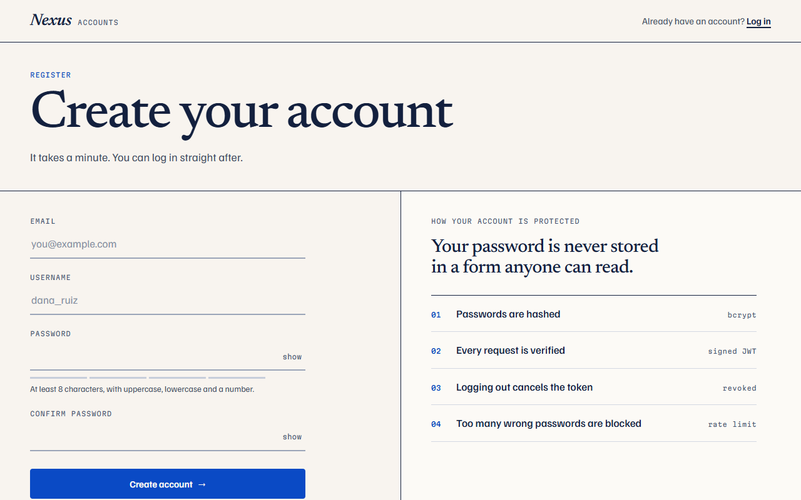 | 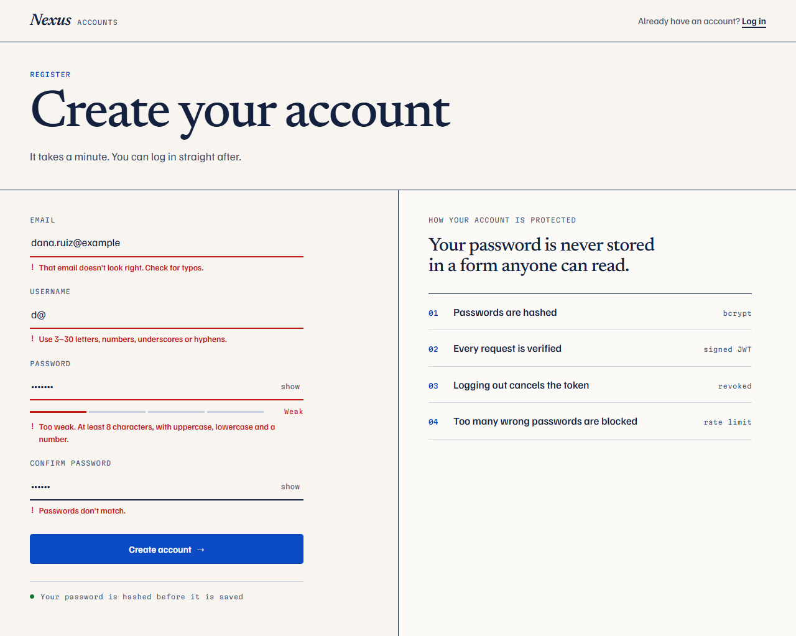 |

| Register, filled in | Account created |
| --- | --- |
| 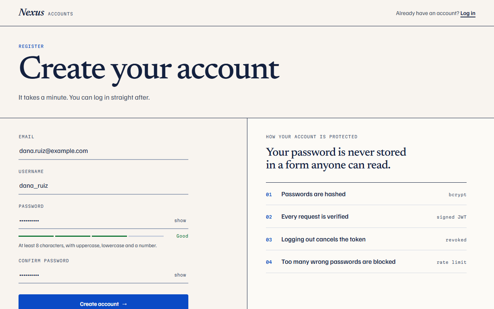 | 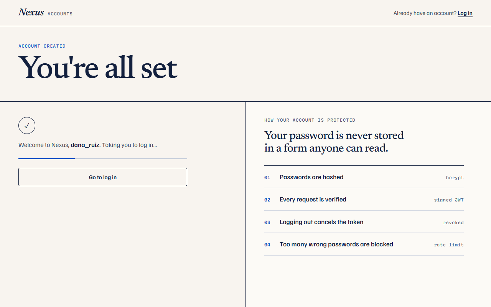 |

| Log in | Log in after registering |
| --- | --- |
| 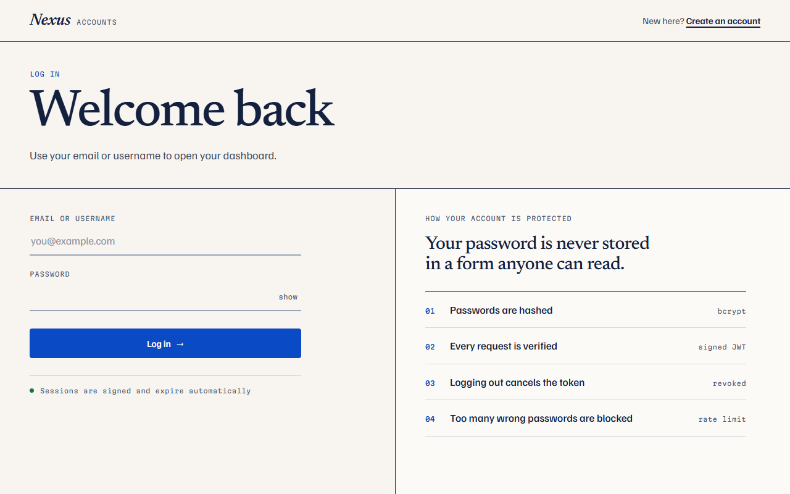 | 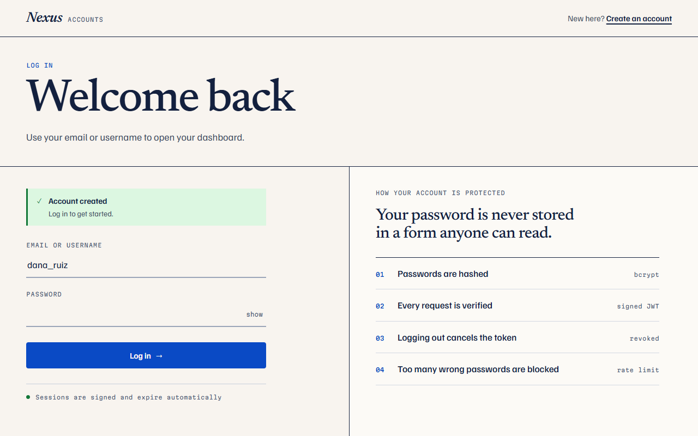 |

| Log in with wrong credentials | Protected dashboard |
| --- | --- |
| 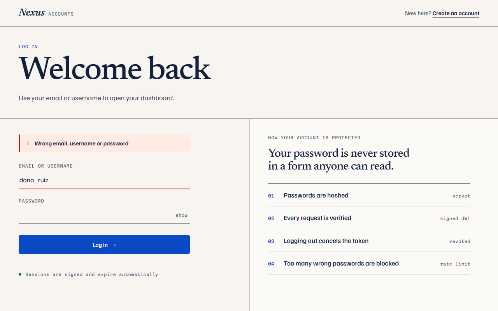 |  |

| Register on a phone | Log in on a phone, after logging out | Dashboard on a phone |
| --- | --- | --- |
| 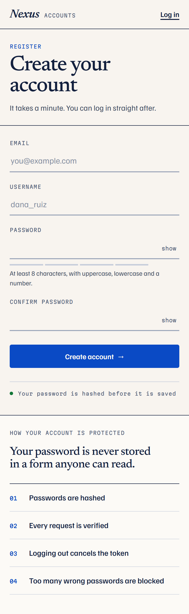 | 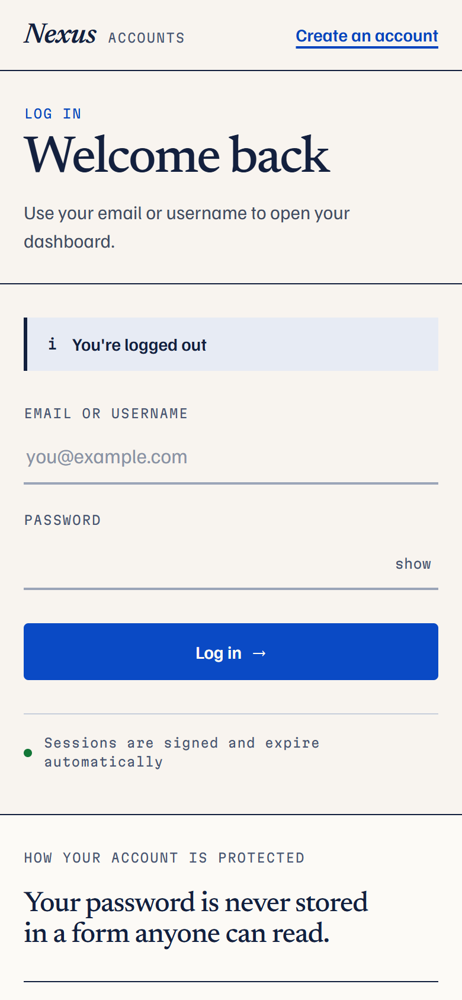 | 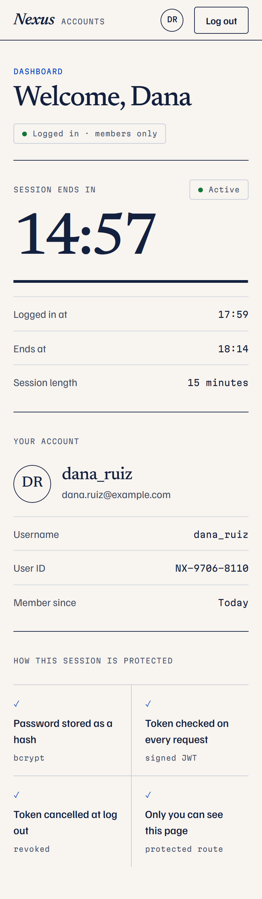 |

The screenshots were taken from the running app with a sample account on a separate test database.

## Known Limitations

- **The token is kept in `localStorage`.** JavaScript on the page can read it, so a cross-site scripting bug would expose it. The short 15-minute lifetime and server-side revocation limit the damage. An HttpOnly cookie would be safer but would change how the frontend and API talk to each other.
- **No refresh tokens.** After 15 minutes the user logs in again.
- **Logout ends one session.** There is no "log out everywhere".
- **Rate limits are kept in memory**, per server process and per IP address. They reset when the server restarts and would need a shared store behind a load balancer.
- **No email verification, password reset or account deletion.** They are not part of the task.
- **No HTTPS locally.** A real deployment must use HTTPS.
- **Dependency audit.** `npm audit --omit=dev` reports no known vulnerabilities in the backend's runtime packages. The development tools (Jest, nodemon) and the frontend's Vite 5 and React Router 6 have advisories that are only fixed in new major versions; those upgrades were not made here.
- **Fonts come from Google Fonts.** Without an internet connection the app works but falls back to a system font.
- **Tested in Chrome only.**

## Troubleshooting

**`'vite' is not recognized as an internal or external command`**
The frontend packages are not installed. Run `npm install` inside the `frontend` folder, then `npm run dev` again.

**`Cannot find module 'dotenv'` (or any other module)**
The backend packages are not installed. Run `npm install` inside the `backend` folder.

**`No matching version found for jsonwebtoken@^9.1.2`**
Version 9.1.2 of `jsonwebtoken` does not exist. `backend/package.json` asks for `^9.0.2`. If you still see this error, an old copy of `package.json` is being used; make sure the line reads `"jsonwebtoken": "^9.0.2"` and run `npm install` again.

**`Configuration error. The server cannot start`**
The message lists what is missing. Create `backend/.env` from `backend/.env.example` and set `MONGODB_URI` and a `JWT_SECRET` of at least 32 characters.

**`MongoDB connection failed`**
MongoDB is not running or the address is wrong. Start the service (`net start MongoDB` in an Administrator terminal on Windows) and check `MONGODB_URI`.

**The login page says "We couldn't reach the server"**
Either the backend is not running, or `FRONTEND_URL` in `backend/.env` does not match the frontend's address. It must be `http://localhost:5173`. Restart the backend after changing it.

In the browser console this second case appears as "blocked by CORS policy: No 'Access-Control-Allow-Origin' header is present". The backend reads `.env` only when it starts, so a change to `FRONTEND_URL` has no effect until the backend is stopped (Ctrl+C) and started again. The address must match exactly: `http://localhost:5173` and `http://127.0.0.1:5173` are different origins.

**`Port 5173 is already in use`**
Another app is using the frontend's port. Stop that app, then run `npm run dev` again.

**`port 5001 is already in use`**
Another program is using the backend's port. Stop it, or change `PORT` in `backend/.env` and set `VITE_API_URL` in `frontend/.env` to match.

**"Too many attempts"**
The rate limit was reached. Wait 15 minutes or restart the backend.
